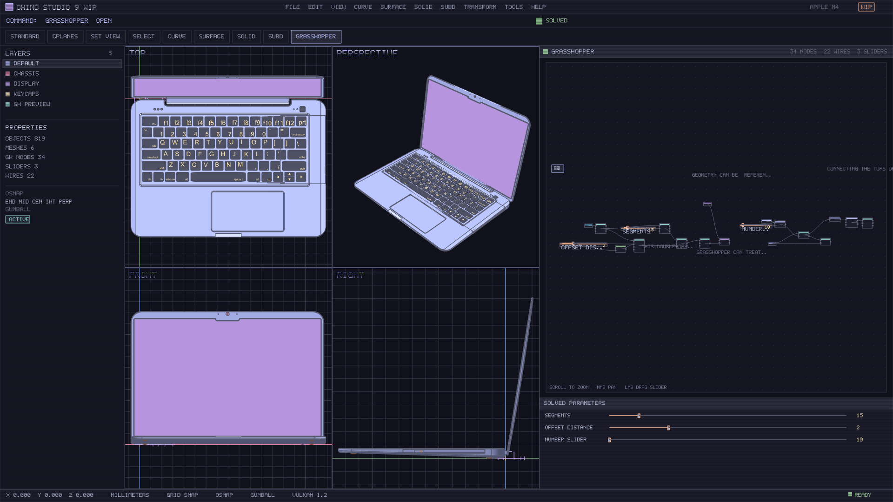

<p align="center">
  
</p>

<h1 align="center">Ohino</h1>

<p align="center"><b>A visual programming and parametric modeling tool and design software.</b></p>

<p align="center">
  Open-source NURBS modeling kernel · Rhino <code>.3dm</code> compatible ·
  Grasshopper <code>.gh</code> / <code>.ghx</code> / <code>.ghz</code> parametric engine ·
  SDL3 + Vulkan cross-platform GUI
</p>

<p align="center">
  <a href="https://github.com/Wang-Yang-source/Ohino/releases/latest"><b>Download Latest Releases (Windows / macOS / Linux)</b></a>
  ·
  <a href="https://github.com/Wang-Yang-source/Ohino">github.com/Wang-Yang-source/Ohino</a>
</p>

| Platform | Architecture | Direct Download |
| --- | --- | --- |
| **macOS** | Apple Silicon (`arm64`) | [`Ohino-v0.2.0-macos-arm64.dmg`](https://github.com/Wang-Yang-source/Ohino/releases/download/v0.2.0/Ohino-v0.2.0-macos-arm64.dmg) · [`.pkg`](https://github.com/Wang-Yang-source/Ohino/releases/download/v0.2.0/Ohino-v0.2.0-macos-arm64.pkg) · [`.tar.gz`](https://github.com/Wang-Yang-source/Ohino/releases/download/v0.2.0/Ohino-v0.2.0-macos-arm64.tar.gz) |
| **Windows** | 64-bit (`x86_64`) | [`Ohino-v0.2.0-windows-x86_64.exe`](https://github.com/Wang-Yang-source/Ohino/releases/download/v0.2.0/Ohino-v0.2.0-windows-x86_64.exe) (NSIS installer, GUI + Vulkan included) · [`.zip`](https://github.com/Wang-Yang-source/Ohino/releases/download/v0.2.0/Ohino-v0.2.0-windows-x86_64.zip) (portable)

---

## What is Ohino?

Ohino is an open-source NURBS modeling tool and parametric design environment. It reads and writes
Rhino's `.3dm` (OpenNURBS) archives, loads Grasshopper definitions natively, and evaluates them
through its own C++ geometry kernel — then displays everything in a Rhino 9-style workbench built on
**SDL3 + Vulkan 1.2** (MoltenVK on macOS, native drivers on Windows/Linux).



*`opentl_cli --render-gui --input-3dm model.3dm --input-gh "07 Column Arcade.gh"` — 383-object
laptop assembly in four viewports, live Grasshopper canvas with groups, wires, sliders and the
solved-parameter inspector, all rendered at 1920×1080 with 4× MSAA.*

### Core capabilities

| Area | What works today |
| --- | --- |
| **NURBS kernel** | Points, lines, polylines, circles, arcs, planes, NURBS curves/surfaces, Breps, SubD, meshes — built on openNURBS with Ohino's own intersection, meshing and boolean layers |
| **`.3dm` I/O** | Real `ONX_Model` read/write: geometry, layers, names, stable IDs; tolerant read of third-party archives including cached render meshes and `ON_Extrusion` |
| **Grasshopper** | Native binary `GH_Archive` reader (raw-deflate + typed chunk tree), `.ghx` XML, DataTree branches, component/wire graph, Kahn DAG solve, slider re-evaluation, bake-to-scene |
| **Studio GUI** | Rhino 9 WIP layout: menu, command line, tool tabs, layers/properties dock, 2×2 viewports, Grasshopper canvas, solved-parameters panel, status bar — same layout in headless PNG renders and interactive windows |
| **Rendering** | Vulkan 1.2 with Catppuccin Mocha theme, 4× MSAA, `D32_SFLOAT` depth, Blinn-Phong shading, screen-space silhouette/crease edges |

---

## Grasshopper support (`.gh` / `.ghx` / `.ghz`)

Ohino parses the real Grasshopper archive format rather than re-implementing a lookalike:

* **`.gh`** — `GH_Archive` = raw deflate stream (`wbits = -15`) → recursive `GH_Chunk` tree
  (`7-bit length-prefixed name`, `int32` index / item count / chunk count) → 25 strongly typed
  `GH_Types` items (`bool`, `int32/64`, `float/double`, `Guid`, `string`, `byte[]`, `double[]`,
  `GH_Point3D`, `GH_Interval1D`, `GH_Line`, `GH_BoundingBox`, `GH_Plane`, …).
* **`.ghx`** — the XML flavour of the same tree (chunk / items / item).
* **`.ghz`** — Grasshopper 2 ZIP container: extracted in-memory via local file headers + raw deflate,
  supporting both nested `.gh`/`.ghx` definitions and GH2 Pear binary `Document.root` archives
  (such as `CircleRadius.ghz`).
* Extracted per object: component GUID, instance GUID, canvas `Bounds`/`Pivot`, input/output ports
  (both the `param_input`/`param_output` layout and the variable-parameter
  `ParameterData → InputParam/OutputParam` layout), `Source` wires, `PersistentData` branches,
  `Number Slider` ranges/values, `Panel` text, `Scribble` notes and dynamic `Group` membership boxes.
* Solved components include `Number Slider`, `Point`, `Construct Point`, `Deconstruct`, `Distance`,
  `Line`, `Line SDL`, `Circle`, `Circle Radius`, `Circle 3Pt`, `Arc`, `Nurbs Curve`, `Interpolate`,
  `Divide Curve`, `Curve Closest Point`, `Offset Curve` (`TL_OffsetCurve`), `Poisson Distribution`,
  `Bounding Box`, `Box Corners`, `XY Plane`, `Plane Offset`, `Addition`, `Subtraction`,
  `Multiplication`, `Division`, `Average`, `Range`, `Bounds`, `Remap Numbers`, `Expression`,
  `Format`, `Loft`, `Sweep1` (`TL_Sweep1Rail`), `Sweep2` (`TL_Sweep2Rails`), `SubD Box`,
  `Mesh Plane`, `Brep | Line`, `Custom Preview` — all evaluated by the Ohino kernel, not by a mock.

All eight definitions shipped with Rhino 9 WIP (`00`–`07`) plus the GH2 `CircleRadius.ghz` example load and solve:

```
00 From Rhino To Grasshopper     8 nodes   0 sliders   1 baked
01 Simple Input and Maths       14 nodes   3 sliders   0 baked (numeric output)
02 Interpolating Values         21 nodes   1 slider    6 baked
03 Wires and Conversions        17 nodes   1 slider    3 baked (1 mesh)
04 Polynomial Graphing          20 nodes   4 sliders   1 baked
05 Measure and Display Values   24 nodes   0 sliders  60 baked
06 Adaptive Pattern             29 nodes   0 sliders  33 baked
07 Column Arcade                34 nodes   3 sliders  54 baked   22 wires
CircleRadius.ghz (GH2)           4 nodes   1 slider   56 baked    2 wires
```

---

## Architecture

```
Ohino
├── Ohino kernel (C++20)              include/opentl, src/
│   ├── mvp/          scene document, transforms, distances, JSON + .3dm I/O
│   ├── intersect/    curve×curve (2 solvers), surface×surface marching + periodic NURBS fit
│   ├── closest_point/ curve/surface closest-point Newton solvers
│   ├── fitting_loft_sweep/  deformable arc/circle, offset curve, loft, 1-rail & 2-rail sweep
│   ├── meshing/      surface gridding, unwelded-edge detection, boundary capping, Brep→mesh
│   ├── booleans/     winding numbers, planar slicing, mesh CSG
│   ├── subd/         SubD box + SubD→mesh
│   ├── viewport/     4-view cameras/projection/picking + Vulkan 1.2 renderer
│   ├── gh/           Grasshopper (.gh/.ghx/.ghz) archive reader + DAG solver
│   └── gui/          Rhino 9 studio layout + 3D Gumball/OSnap + SDL3 interactive window
├── apps/opentl_cli   demo, inspect, four-view, Vulkan render, studio GUI render & interactive window
├── tests/            20 sections, 2827 checks
├── docs/             PRD_RHINO9_GH_AND_GUI.md, TODO.md
└── assets/           logo + screenshots
```

Geometry is layered on **openNURBS** (`external/opennurbs`, v8.35) for data structures, NURBS
evaluation and `.3dm` serialization; everything Ohino claims to *compute* (intersections, capping,
booleans, SubD, Grasshopper solving, rendering) is implemented in this repository.

---

## Build

Requirements: CMake ≥ 3.16, a C++17 compiler, and the bundled `../external/opennurbs`.
Vulkan is optional — without it the renderer reports a clear error instead of silently degrading.

```bash
# macOS: Vulkan via MoltenVK
brew install vulkan-headers vulkan-loader molten-vk shaderc

cmake -S . -B build -DCMAKE_BUILD_TYPE=Release
cmake --build build -j8
```

Linux/Windows use the same `CMakeLists.txt` (native Vulkan ICDs, MSVC 2019+).

```bash
ctest --test-dir build --output-on-failure     # 5/5 tests
```

---

## Run

```bash
# Deterministic kernel demo + JSON/.3dm round-trip
./build/opentl_cli --demo --out-dir /tmp/out

# Four-view camera layout (backend independent)
./build/opentl_cli --views --out-dir /tmp/out

# Vulkan four-view render (1600x900)
./build/opentl_cli --render-vulkan --scene demo --out-dir /tmp/out

# Rhino 9 style studio workbench, 1920x1080, with .3dm + Grasshopper (headless PNG)
./build/opentl_cli --render-gui \
  --input-3dm model.3dm \
  --input-gh "07 Column Arcade.gh" \
  --out-dir /tmp/out        # writes studio.png

# Interactive SDL3 + Vulkan desktop studio window (Orbit/Pan/Zoom + live GH slider drag)
./build/opentl_cli --gui \
  --input-3dm model.3dm \
  --input-gh "07 Column Arcade.gh"

# Inspect archives
./build/opentl_cli --inspect-3dm model.3dm
```

Minimal API use:

```cpp
#include "opentl/opentl.h"

TL_GhDocument gh;
std::string err;
if (gh.LoadFile("07 Column Arcade.gh", &err)) {
  gh.SetSliderValue("Segments", 30.0);          // re-solves the DAG downstream

  opentl::mvp::SceneDocument scene;
  std::vector<ON_Mesh*> meshes;
  std::vector<const float*> colors;
  gh.BakeToScene(scene, meshes, &colors);      // geometry lands in the scene
}

TL_FourViewLayout layout = TL_FourViewLayout::Default(1920, 1080);
const TL_GuiStudioRects rects = TL_ComputeStudioRects(1920, 1080);
TL_ApplyStudioViewports(layout, rects);        // 4 views inside the workbench
```

---

## Verification

| Check | Result |
| --- | --- |
| `opentl_tests` | **20 sections, 2827 checks, 0 failures** |
| `ctest` | **5/5 passed** (`opentl_tests`, cli demo/views/vulkan/gui) |
| `.gh` / `.ghz` fixtures | 8/8 Rhino 9 WIP `.gh` tutorials + GH2 `CircleRadius.ghz` parse & solve (`07` bakes 54 objects, `CircleRadius.ghz` bakes 56 objects) |
| Slider re-solve | `Segments` 15 → 30 and GH2 `Radius` 10 → 18 update downstream geometry |
| Studio render & SDL3 GUI | 1920×1080 PNG + SDL3 interactive window, `Vulkan 1.2.357` / `Apple M4`, 4× MSAA, `D32_SFLOAT`, 72 964 line vertices, 1 319 876 triangles |
| `.3dm` model | 383 objects, 309 Breps, 241 620 faces, four consistent viewports with 3D Gumball + `CEN` OSnap |

---

## Status & limits (honest list)

* Surface×surface intersection handles closed, open and tangential branches with measured error
  (`≤ 5e-9` periodic fit, `1.3e-15` on a tangent line); self-intersecting cases and tolerance
  propagation are not covered.
* Brep booleans are mesh-based (`TL_MeshBoolean`); there is no `ON_BrepSplitter`-level face
  splitting, so results are watertight meshes rather than trimmed Breps.
* Grasshopper coverage is the component set listed above. Definition *editing* (adding/removing
  components, dragging wires) is not implemented — sliders and persistent data are editable.
* `.ghz` (Grasshopper 2 ZIP + Pear `Document.root`) is unpacked and solved in-memory; internalised
  geometry stored as `ON_Data` blobs is decoded when the buffer is a plain `ON_Object` archive.
* The interactive window mode shares the same layout/draw list as the headless renderer; mouse
  camera navigation and slider dragging are wired through `TL_Viewport` and the GH document, but
  the desktop event loop is deliberately thin compared with Rhino's command system.
* No dynamic analysis of any commercial binary: the `.3dm`/`.gh` behaviour is derived from public
  formats plus static export/import evidence kept in `re-database/`.

---

## Documentation

* [`docs/PRD_RHINO9_GH_AND_GUI.md`](docs/PRD_RHINO9_GH_AND_GUI.md) — product requirements for the
  Grasshopper engine and the Rhino 9 style workbench.
* [`docs/TODO.md`](docs/TODO.md) — staged roadmap and open work.
* `re-database/` — static evidence: export/import tables, three-tier call maps, REA records.

## License & trademarks

openNURBS is © Robert McNeel & Associates, used under its bundled license. Rhino, Grasshopper and
openNURBS are trademarks of Robert McNeel & Associates; Ohino is an independent interoperable
implementation and is not affiliated with or endorsed by them.
